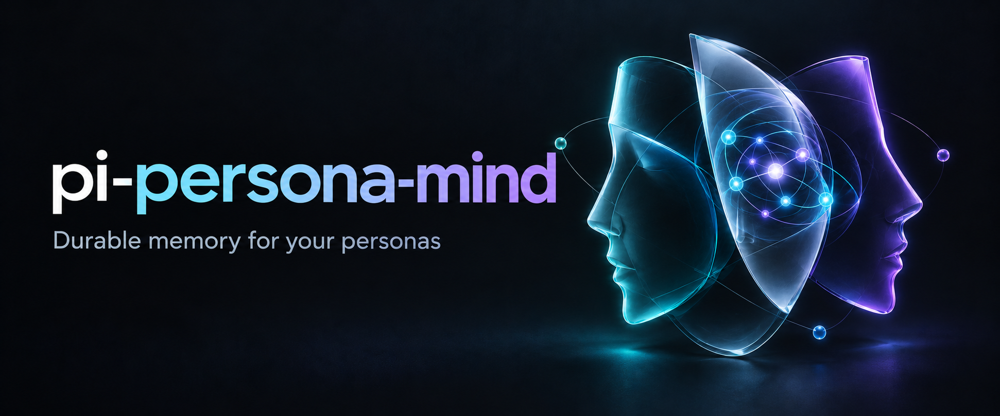

<h1 align="center">pi-persona-mind</h1>

<p align="center">
  
</p>

[](https://github.com/AeonDave/pi-persona-mind/actions/workflows/test.yml)
[](https://www.npmjs.com/package/@aeondave/pi-persona-mind)
[](LICENSE)

**Local, scoped memory for Pi.** Keep useful project decisions, persona preferences, session notes
and deferred work without turning every conversation into permanent memory.
Mind complements Pi's native conversation history and compaction; it does not replace them.

## Features

| What you need | What Mind provides |
|---|---|
| Continue a long project | Durable repository decisions, session notes and explicit handoffs for the next session |
| Keep context focused | Bounded retrieval by words, code identifiers, tags and paths, with explicit full-record reads |
| See what the agent remembers | **F10**: saved facts, prepared context and an active-branch timeline |
| Maintain a growing archive | Bounded consolidation, evidence-grounded review, change history and guarded undo |
| Understand a changed decision | Retained before/after records for explicit replacements, kept out of active recall |

Memory is stored in local files and Pi's native session history. Recall and browsing need no model
call. [Automatic consolidation](#quiet-automatic-maintenance) is on by default; it and explicit
knowledge reviews use the current session model and incur model usage.

## Quick start

Mind 0.9.4 requires **Pi 1.6.0**, **Node.js 22.19.0+**, and
[**pi-persona 1.18.1+**](https://github.com/AeonDave/pi-persona) loaded in the same instance.

```bash
pi install npm:@aeondave/pi-persona
pi install npm:@aeondave/pi-persona-mind
```

For existing installations, use `pi update npm:@aeondave/pi-persona` and
`pi update npm:@aeondave/pi-persona-mind`. Restart Pi or run **`/reload`** after installing or
updating; `/persona reload` alone does not reload extension code. Keep only one installation source
per extension and remove the old source before switching between npm and Git.

Mind needs a **compatible, running Persona**, not just an installed package or settings file.
Without that companion and its current session owner, memory operations and background activity stay
inactive. See [host and companion integration](docs/DESIGN.md#scope-and-companion-integration).

Try asking your agent:

- “Save this as a durable project decision: schema changes require a migration.”
- “Keep this constraint only for the current session.”
- “Remember this preference across projects for this persona.”
- “Put the blocked migration in the backlog and remind me tomorrow.”
- “Recall the decision about retries and show the complete saved record.”
- “Save a handoff with the goal, completed work, remaining work, next step and references.”

Press **F10** to inspect what Mind has saved and prepared. Use **`/mind`** for a snapshot,
**`/mind help`** for commands and **`/mind doctor`** for effective settings and storage warnings.

## Memory that fits the work

Choose the lifetime and scope that match your intent:

| Memory | Where it belongs | Lifetime |
|---|---|---|
| Session notes | The active native session branch | Survive compaction and persisted resume; stay out of new sessions and workers |
| Project working memory | Temporary repository context | 48 hours by default |
| Durable project memory | Repository decisions | Until changed or forgotten |
| Persona memory | One persona across projects | Until changed or forgotten |
| Shared memory | Deliberately shared across personas | Until changed or forgotten |
| Backlog | Deferred project work and reminders | 48 hours by default; later reminders extend expiry |

The agent chooses scope from your intent; durable saves require an explicit `project`, `persona`
or `shared` destination. Strong direct-user cues may be captured automatically, but
**automatic capture creates provisional session notes only**, even for “remember” or “from now on”.
Broader retention requires a separate deliberate `memory` call with an explicit durable scope.

Reminders notify you while Pi is open; they do not wake the model. Delegated workers receive a lean
memory selection, without session notes or memory/backlog write tools. Home-directory sessions skip
project injection and reminders. See [lifetimes and scope](docs/DESIGN.md#four-lifetimes) and
[session notes](docs/DESIGN.md#session-notes) for persistence, branch-local forgetting and expiry.

## Retrieval and inspection

Mind selects relevant excerpts each turn within one shared context budget. Exact words and paths
receive more weight than matches across code identifiers (`HTTPResponseParser` → “HTTP response parser”)
and vowel accents (`café` → “cafe”). Unicode text remains searchable. This is lexical retrieval;
it can miss paraphrases or conflicting facts. Use `memory recall`
to search and `memory read` to inspect a complete record. The budget is an estimate, not a billing counter.

**F10** toggles the read-only inspector in the interactive TUI:

- **Memories** browses scoped facts, full text, dates, tags and available recording provenance.
- **Context** shows the last block prepared by Mind, including omissions—not the final provider payload.
- **Timeline** shows bounded user/assistant text and session-note events on the active branch.

Open a record for detail and press **s** for its recording source, when available. Recording provenance
shows how a fact was saved; it does not verify the assertion. Timeline and source lookup cover a
bounded active-branch window.

In Memories, **a** opens maintenance actions; `/mind browse`, `/mind browse context` and `/mind timeline`
are command alternatives. Browsing alone is read-only and makes no model calls.

F10 shares Persona's F9 window frame and theme. **PageUp/PageDown** follow visible rows, narrow
windows keep the selection visible, and **?** opens help. See the
[inspector design](docs/DESIGN.md#read-only-memory-inspector) for navigation, sources and coverage.

## Maintain knowledge deliberately

**Decision history** keeps the previous fact when an explicit replacement retires it. Use
`/mind history project-long` to find a receipt and `/mind history show <receiptId> project-long`
to inspect its before/after records. Old facts stay out of active recall and injected context.
History is bounded; ordinary replacements are inspectable, while guarded undo applies to consolidation.
[History and retention →](docs/DESIGN.md#replacement-history)

**Consolidation** merges compatible saved facts and applies validated changes. `/mind optimize`
reviews one bounded window per allowed project/persona tier; `/mind optimize project-long` selects
durable project memory alone. Inspect changes with `/mind optimize history`; `/mind optimize undo`
restores affected facts only when its conflict checks pass. This reorganizes saved knowledge; it does
not verify it against your repository. [Consolidation and undo details →](docs/DESIGN.md#explicit-consolidation)

**Knowledge review** runs in the interactive terminal and checks selected facts against repository
files you choose and bounded active-branch user-role text. Repository evidence requires project trust.
The worker proposes corrections, conflicts, insufficient-evidence findings or retirement
recommendations for your review.

1. Choose **F10 → Memories → a**, or run `/mind review project-long` (also `project` or `persona`).
2. Select evidence and confirm the model call. Inspect the proposal with `/mind review show`.
3. Use `/mind review apply` to separately approve corrections, or `/mind review discard` to discard them.
   Application rechecks evidence and memory freshness. Retirement is a recommendation; forgetting a
   fact is a separate deliberate action.

Both workflows use a **visible Persona-hosted Mind worker on the current session model** and incur
model usage. Choose a model with `/model` before starting. New input or model, branch, session and
owner changes invalidate pending review work. Shared memory and session notes are excluded from
these model-driven mutations. Reviews and undo history are bounded; a reviewed window is not a
whole-archive audit or a guarantee of truth.

### Quiet automatic maintenance

Automatic consolidation is on by default. After eligible saves, it waits for the foreground to become
idle and respects usage, cooldown and ownership limits. A real worker is visible in Persona;
successful changes produce one small **mind** notification, while routine no-ops stay quiet.
Failures and important warnings remain visible, and applied changes retain history for guarded undo.

Use `/mind optimize auto status`, `/mind optimize auto off` or `/mind optimize auto on` for the current
session. `PI_PERSONA_MIND_OPTIMIZE=off` disables automatic optimization at startup. Capture can be set
with `PI_PERSONA_MIND_CAPTURE=auto|prompt|off`, and `PI_PERSONA_MIND_NUDGE=off` disables suggestions.
See [automatic review](docs/DESIGN.md#automatic-semantic-review) for admission and cost details.

## Hand off a long task

Ask the agent to save a handoff before switching sessions. It records the goal, completed work,
pending work, next step and references, together with the originating session and branch.
In a new session with the same project and persona, use **`/mind handoff list`** and
**`/mind handoff show <id>`** to consult it.

A handoff is an explicit work snapshot, not proof that a task is complete. It is never injected or
executed automatically. Completion requires a resolution; forgetting is explicit. Each persona can hold
up to 32 handoffs in a bounded project file (128 KiB for the whole file), with no automatic expiry or
eviction.
[Commands, ownership and limits →](docs/DESIGN.md#cross-session-handoffs)

## Learn more

- [Design: lifetimes, storage, limits, commands and safeguards](docs/DESIGN.md)
- [Evidence-grounded review and approval](docs/DESIGN.md#evidence-grounded-knowledge-review)
- [Storage recovery and concurrent writes](docs/DESIGN.md#durable-files-and-recovery)
- [Architecture decisions and evaluation boundaries](docs/MEMORY-RESEARCH.md)
- [Release history](CHANGELOG.md) · [MIT license](LICENSE)
